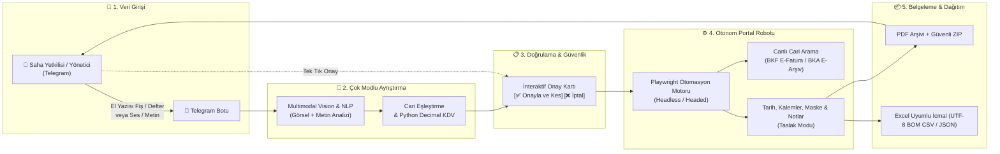

<div align="center">

# ⚡ e-Fatura Süreç Otomasyonu
### İşletmeler, KOBİ'ler ve Muhasebe Ekipleri İçin Çok Modlu e-Fatura & e-Arşiv Entegrasyon Motoru

**El yazısı notlardan, adisyon/çetele fotoğraflarından ve Telegram ses/metin mesajlarından tek tıkla resmi e-fatura taslağı oluşturan kurumsal süreç otomasyonu.**

<br/>

[](https://github.com/whywouldnt)
[](https://playwright.dev/)
[](https://core.telegram.org/)
[](README.md)

<br/>

[🌟 Özellikler](#-öne-çıkan-özellikler) • [🏗️ Mimari & Çalışma Mantığı](#️-mimari--çalışma-mantığı) • [📱 Kullanım Senaryoları](#-kullanım-senaryoları) • [💼 İşletmeniz İçin İletişim & Entegrasyon](#-işletmeniz-için-iletişim--entegrasyon)

</div>

---

## 💡 Çözülen Problem

Saha dağıtımı yapan toptancılar, üretim atölyeleri, perakendeciler, serbest meslek sahipleri ve mali müşavirler için ay sonu faturalama süreçleri ciddi bir zaman ve operasyon maliyetidir:

- ❌ **Dağınık Notlar & Karışık İletişim:** Gün boyu WhatsApp/Telegram yazışmalarına dağılmış siparişler, el yazısıyla tutulmuş depo defterleri, adisyonlar veya karalanmış fişler.
- ❌ **Manuel Portal Operasyonları:** E-Fatura veya muhasebe portallarına tek tek girip müşteri aramak, VKN/TCKN doğrulamak, satır satır kalem ve KDV oranları girmek.
- ❌ **Kullanıcı & Kuruş Hataları:** Yanlış KDV tevkifatı, portal maskelerinde ondalık yutulması veya yanlış firmaya fatura kesilmesi gibi mali riskler.
- ❌ **Gereksiz Mesai Kaybı:** Ay sonlarında işletme yöneticilerinin ve muhasebe personelinin saatlerce fatura ekranlarına kilitlenmesi.

> **Bu Çözüm Ne Sağlıyor?**  
> Saha personeli, şirket yöneticisi veya muhasebeci; el yazısı defterin/sipariş fişinin fotoğrafını çeker ya da Telegram'dan tek bir mesaj atar (*"kardesler 120 koli urun 85 tl, ozlem 50 paket malzeme"*).  
> Sistem görseli veya metni saniyeler içinde çözümler, resmi ticari kayıtlarla eşleştirir, KDV ve kuruş sağlamasını yapar. Telegram'dan tek tıkla onay verildiği anda tarayıcı robotu portala girerek faturaları ilgili döneme resmi taslak olarak işler, ekran görüntüsünü alır ve PDF'leri teslim eder.

---

## 🏗️ Mimari & Çalışma Mantığı



---

## 🌟 Öne Çıkan Özellikler

### 1. 📸 Çok Modlu (Multimodal) Görsel & El Yazısı OCR
- Masadaki el yazısı sipariş defterlerini, adisyonları, sevk irsaliyelerini ve karalama notlarını yüksek doğrulukla okur.
- Türkçe karakter eksikliklerine, kısaltmalara ve işletme içi gayriresmi müşteri takma adlarına karşı esnek doğal dil eşleştirmesi uygular.
- Belge üzerindeki fatura açıklamalarını ve özel notları ayrıştırarak portaldaki ilgili faturanın açıklama alanına aktarır.

### 2. ⚡ Akıllı Portal Entegrasyonu (Robotic Process Automation)
- **Canlı Cari Arama:** Portaldaki kayıtlı alıcıları arama motorundan milisaniyeler içinde bulur; yerel rehberde VKN olmasa bile kesim aksamaz.
- **Otomatik Modül Tespiti:** Alıcının durumuna göre sistemi otomatik olarak **E-Fatura (`BKF`)** veya **E-Arşiv (`BKA`)** modülüne yönlendirir.
- **Dönem Sonu Kuralı:** Ay başında kesilen faturaların resmi tarihini hatasız biçimde bir önceki ayın son gününe (ör. `31.10.2026`) ayarlar.
- **Gelişmiş Inputmask Koruması:** Portalın özel maskeli birim fiyat alanlarında kuruş yutulması (`12.5` yerine `125` yazılması) gibi riskleri ortadan kaldıran doğrulamalı giriş mekanizması barındırır.
- **Kendi Kendini Onaran Oturum (Self-Healing):** Tarayıcı kapansa, profil kilitlense veya oturum düşse bile sistemi yeniden ayağa kaldırıp işlemi tamamlar.

### 3. 🛡️ Finansal Güvenlik & Sıfır Hata Prensibi
- **Taslak Modu Güvencesi:** Faturalar doğrudan resmi GİB onayına gitmez; önce portalın *"Taslak Faturalar"* ekranına kaydedilir, ekran görüntüsü alınır ve kullanıcının son kontrolüne sunulur.
- **Kuruş Sağlama Freni (Fail-Closed):** Portalın hesapladığı genel toplam ile taslak toplamı arasında kuruş farkı tespit edilirse işlem güvenlik gereği derhal durdurulur.
- **Yetkilendirme:** Sistem sadece kurum tarafından yetkilendirilen kullanıcı kimlikleri (Chat ID / Telefon) ile çalışır; yabancı erişimleri engeller.

### 4. 📊 Muhasebe ve Arşivleme Standartları
- Kesilen tüm faturalar `output/YYYY-MM/` dizininde cari ünvanı ve fatura numarasına göre düzenli kataloglanır.
- Mali müşavirlerin doğrudan Excel'de açabileceği Türkçe karakter uyumlu UTF-8 BOM formatında **İcmal CSV** ve **JSON** raporları üretir.
- Zip-Slip ve symlink korumalı güvenli arşivleme ile toplu ZIP paketi oluşturulup anında Telegram'a gönderilir.

---

## 📱 Kullanım Senaryoları

````carousel
<!-- slide -->
### 💬 Senaryo 1: Hızlı Metin / Sipariş Girişi
Kullanıcı sahada veya hareket halindeyken Telegram'dan tek bir mesaj atar:
```text
bioden 100 koli a4 kagit 125 tl aciklama: ekim siparisi, santex 20 paket toner 850 tl
```
<!-- slide -->
### 📋 Senaryo 2: Anında Doğrulanmış Onay Kartı
Sistem mesajı milisaniyeler içinde işler, carileri tespit eder ve onay kartını sunar:
```text
📋 Fatura Taslağı (2 Adet Alıcı):
━━━━━━━━━━━━━━━━━━━━━
1️⃣ BİODEN KIRTASİYE LTD. ŞTİ.
   • Tarih: 31.10.2026 (Dönem Sonu)
   • Tür: E-FATURA [BKF]
   • Kalemler: 100 Koli A4 Kağıt x 125,00 TL (%20 KDV)
   • 📝 Not/Açıklama: ekim siparisi
   • Ara Toplam: 12.500,00 TL | Toplam: 15.000,00 TL

2️⃣ SANTEX TEKNOLOJİ A.Ş.
   • Tarih: 31.10.2026 (Dönem Sonu)
   • Tür: E-ARŞİV [BKA]
   • Kalemler: 20 Paket Toner x 850,00 TL (%20 KDV)
   • Ara Toplam: 17.000,00 TL | Toplam: 20.400,00 TL
━━━━━━━━━━━━━━━━━━━━━
Genel Toplam: 35.400,00 TL

[✅ Onayla ve Kes]  [❌ İptal Et]
```
<!-- slide -->
### 📸 Senaryo 3: El Yazısı Fiş / Defter Fotoğrafı
Depodaki el yazısı sevk defterinin veya adisyon fişinin fotoğrafı çekilip gönderilir:
> *"Kasım ayı sonu sevkiyatları, KDV dahil"*
Çok modlu yapay zeka motoru el yazısını çözer, carileri resmi vergi kayıtlarıyla eşleştirir ve onay kartı üretir.
<!-- slide -->
### 🚀 Senaryo 4: Otonom Portal İşlemi & Teslimat
`[✅ Onayla ve Kes]` butonuna basıldığı anda RPA motoru portala bağlanır, taslakları oluşturur; fatura PDF'leri, portal ekran görüntüleri ve Excel icmal listesi Telegram sohbetine anında iletilir.
````

---

## 🛠️ Teknoloji Mimarisi

| Katman | Teknoloji & Standart |
| :--- | :--- |
| **Görsel & Metin Analizi** | Çok Modlu Yapay Zeka (Multimodal Vision OCR & NLP) |
| **Süreç Otomasyonu (RPA)** | Python Playwright (Headless / Headed Tarayıcı Motoru) |
| **Kullanıcı Arayüzü** | Asenkron Telegram Bot API |
| **Veri Doğrulama & Hesaplama** | Pydantic v2, Python `decimal.Decimal` (ROUND_HALF_UP) |
| **Raporlama & Belgelendirme** | Hiyerarşik PDF Kataloglama, UTF-8 BOM CSV, JSON, Güvenli ZIP Arşivi |
| **Mühendislik & Kalite** | Pytest (122 Adet Birim, Entegrasyon ve Güvenlik Testi) |

---

## 🔒 Güvenlik & Kapalı Kaynak Mimarisi

> [!IMPORTANT]
> **Telif ve Fikri Mülkiyet Bildirimi:**  
> Bu depo bir **vitrin ve yetenek tanıtım (showcase) sayfasıdır**. Sistemin yüksek performanslı motor kodları, portal seçici algoritmaları, self-healing oturum mekanizmaları ve iş mantığı kapalı kaynak (**proprietary**) olarak korunmaktadır.

- **Veri İzolasyonu:** Her kurumun verileri, tarayıcı profilleri ve oturum çerezleri tamamen bağımsız ve şifreli çalışır.
- **Sıfır Veri Sızıntısı:** Müşteri veritabanları veya kimlik bilgileri asla harici sunucularla paylaşılmaz.
- **Fail-Closed Tasarım:** Şüpheli veya doğrulanamayan hiçbir işlem resmi portala yansıtılmaz.

---

## 💼 İşletmeniz İçin İletişim & Entegrasyon

Bu sistemi kendi işletmeniz, dağıtım ağınız, e-ticaret operasyonunuz veya muhasebe ofisiniz için kullanmak ister misiniz?

### 🚀 Neler Sunuyoruz?
1. **Kurumunuza Özel Entegrasyon:** Kullandığınız fatura serileri, müşteri rehberiniz ve KDV oranlarınıza göre anahtar teslim kurulum.
2. **Farklı Portal & ERP Uyarlaması:** Veriban haricinde Paraşüt, Bizmu, Uyumsoft, Logo, Mikro vb. farklı e-fatura/muhasebe sistemlerine özel adaptör desteği.
3. **Bulut / Sunucu Altyapısı:** Bilgisayarınızı açık tutmanıza gerek kalmadan 7/24 bulut ortamında Telegram üzerinden kesintisiz operasyon.
4. **Bakım & Mevzuat Desteği:** Portal veya e-fatura mevzuat değişikliklerinde anında güncelleme.

---

### 📩 İletişim Kanalları

Demo talep etmek, sistemi işletmenize uyarlamak veya iş birliği fırsatları için iletişime geçebilirsiniz:

- **GitHub İletişim:** [@whywouldnt](https://github.com/whywouldnt)
- **Demo / İş Talebi:** [GitHub Discussions / Issues Üzerinden Mesaj Bırakın](https://github.com/whywouldnt/e-fatura-surec-otomasyonu/issues)
- **E-posta:** [alirizaicenn@gmail.com](mailto:alirizaicenn@gmail.com)

---

<div align="center">
<sub>Geliştirici & Sistem Mimarı: <strong>whywouldnt</strong> • © 2026 Tüm Hakları Saklıdır.</sub>
</div>
