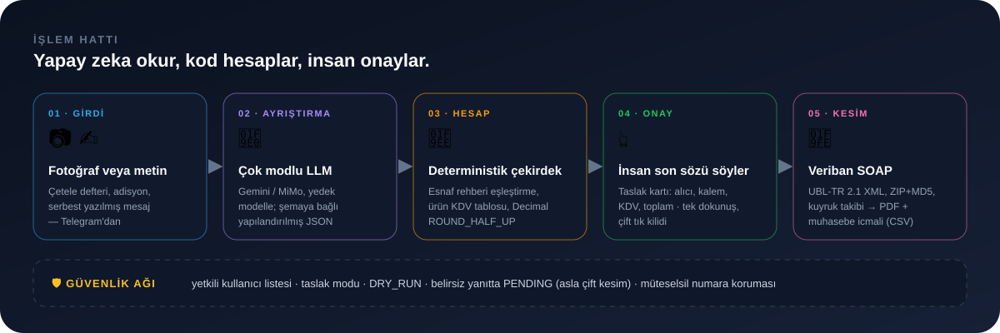
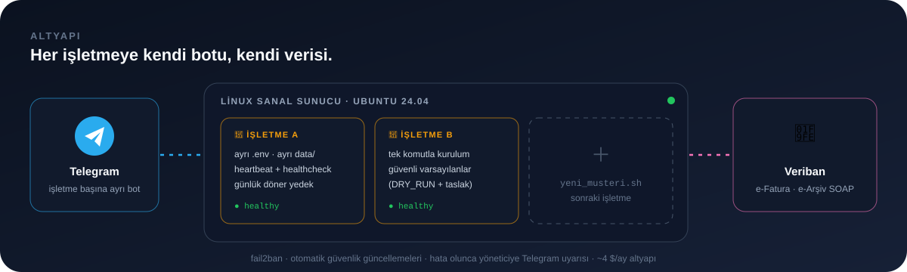

 

**[Nasıl çalışır](#-nasıl-çalışır) · [Mimari](#-mimari) · [Güvenlik ağı](#-güvenlik-ağı) · [Altyapı](#-altyapı) · [Yol haritası](#-yol-haritası) · [İletişim](#-iletişim)**

---

## 🥖 Hikâye

Bu proje bir **aile fırınının** ay başı derdinden doğdu.

Fırın her gün onlarca bakkala, markete ve büfeye ekmek dağıtıyor. Teslimatlar bir **çetele defterine** el yazısıyla işleniyor. Her ayın ilk haftası, geçen ayın tamamı tek tek faturaya dönüşmek zorunda: portala gir, alıcıyı bul, VKN'yi kontrol et, kalemleri yaz, KDV'yi hesapla, kaydet… her esnaf için yeniden.

Bu iş saatler alıyor ve hata affetmiyor. Kesilmiş bir faturayı geri almak zahmetli, numaralar müteselsil, bir kuruşluk fark bile sorun.

**Bu bot o saatleri bir mesaja indiriyor:** defterin fotoğrafını çek ya da aklındakini yaz. Gerisini bot hazırlar, sen yalnızca onaylarsın.

---

## 💬 Nasıl çalışır

 

| | |
|:--|:--|
| **1 · Gönder** | Çetele defterinin fotoğrafı ya da serbest bir mesaj: `yıldız 1200 ekmek 8,5 tl, çınar 400 simit`. Yazım hatası, kısaltma, Türkçe karakter eksikliği sorun değil. |
| **2 · Kontrol et** | Bot esnafı rehberden bulur, e-Fatura mı e-Arşiv mi olduğunu belirler, KDV'yi hesaplar ve tarihi dönem sonuna (önceki ayın son günü) ayarlar. Sonuç tek bir **taslak kartında** görünür. |
| **3 · Onayla** | `✅ Onayla ve Kes` ile faturalar UBL-TR 2.1 olarak Veriban'a gider. PDF'ler ve muhasebeciye hazır **icmal (CSV)** aynı sohbete döner. |

> Bot sohbette `/` yazıldığında tüm komutları açıklamalarıyla listeler. Yöneticinin menüsünde maliyet ve numara yönetimi komutları da görünür; müşterilerinkinde görünmez.

---

## 🏗 Mimari

 

Temel tasarım kararı şu: **Yapay zeka yalnızca okur, hiçbir zaman hesaplamaz.**

LLM'in işi dağınık girdiyi şemaya bağlı yapılandırılmış veriye çevirmekle bitiyor. Esnaf eşleştirme, ürün bazlı KDV oranı, matrah ve toplam tamamen deterministik Python kodunda (`Pydantic v2` + `decimal.Decimal`, `ROUND_HALF_UP`) yapılıyor. Böylece aynı girdi her zaman aynı kuruşu verir. Model yanılsa bile hata taslak kartında görünür ve onaydan geçemez.

<b>Veriban entegrasyonunun ayrıntıları</b>

 

- **Doğrudan SOAP.** Tarayıcı otomasyonu yok. Bot, Veriban'ın resmi `IntegrationService` uç noktalarıyla asenkron `httpx` üzerinden konuşuyor. İlk sürümdeki tarayıcı robotu (Playwright) tamamen kaldırıldı.
- **Çift oturum.** e-Fatura ve e-Arşiv için ayrı oturumlar tutuluyor. Süre dolunca kilit altında yenileniyor ve istek kesintisiz tekrarlanıyor.
- **Mükellef sorgusu.** Alıcının e-Fatura mükellefi olup olmadığı ve GİB posta kutusu etiketi canlı sorgulanıyor, önbellekte tutuluyor.
- **Paketleme.** UBL-TR 2.1 XML hazırlanıyor, ZIP'leniyor, MD5 alınıyor ve Base64 ile aktarılıyor. Ardından kuyruk durumu üstel beklemeyle izleniyor.
- **Belirsizliğe karşı dürüstlük.** Sunucu yanıtı kesinleşmezse fatura `PENDING` olarak işaretleniyor ve **asla otomatik tekrar kesilmiyor**. Çift fatura, gecikmiş faturadan çok daha kötü.
- **Müteselsil numara.** Kesin retlerde numara sayaca iade ediliyor. Sunucuya ulaşmış olabilecek faturaların numarası korunuyor. Yıl geçişinde seri `…2027000000001`'den otomatik başlıyor.
- **Uçtan uca test.** Veriban test ortamına karşı ayrı bir e2e test takımı çalışıyor.

---

## ✨ Öne çıkanlar

<table>
<tr>
<td width="50%" valign="top">

### 📷 El yazısını okur
Çetele, adisyon ve fiş fotoğraflarını satır satır çözer. Esnafın gündelik takma adlarını ("bizim köşedeki bakkal") resmi ünvan ve VKN ile eşleştirir.

</td>
<td width="50%" valign="top">

### 🧮 Kuruşu kuruşuna
Ürün bazlı KDV tablosu (`/kdv`) ve `Decimal` aritmetiği. Çok faturalı paketlerde her açıklama yalnızca kendi faturasına yazılır.

</td>
</tr>
<tr>
<td valign="top">

### 📇 Kendi rehberini kurar
`/rehber_guncelle` geçmiş bir yılın faturalarından esnaf rehberini senkronize eder. Yeni esnaf için `/musteri_ekle` yeterli.

</td>
<td valign="top">

### 🔁 Hataya affedici
Portalda silinen taslağın numarası `/numara_geri` ile geri alınır. `/iptal` yalnızca o sohbetin taslaklarını temizler.

</td>
</tr>
<tr>
<td valign="top">

### 📊 Muhasebeciye hazır
PDF'ler `YYYY-MM/` altında ünvana göre kataloglanır. Excel'de doğrudan açılan UTF-8 BOM icmal ve JSON üretilir.

</td>
<td valign="top">

### 💸 Maliyetini bilir
Her LLM çağrısı token bazında sayılır. `/kullanim` aylık maliyeti işletme başına gösterir, fiyatlandırmanın temeli de bu.

</td>
</tr>
</table>

---

## 🛡 Güvenlik ağı

Resmi bir belge kesen yazılımda "çoğunlukla doğru" yeterli değil. Bu yüzden her katmanın bir freni var:

| Risk | Önlem |
|:--|:--|
| Yabancı biri bota yazar | Yalnızca beyaz listedeki Telegram kimlikleri yanıt alır, gerisi sessizce yok sayılır |
| Aynı fatura iki kez kesilir | Asenkron kilit + çift tıklama koruması + belirsiz durumda `PENDING` (tekrar yok) |
| Yanlış fatura doğrudan GİB'e gider | **Taslak modu**: e-Fatura portalda taslak olarak bekler, insan kesinleştirir |
| Geliştirme sırasında gerçek istek atılır | **DRY_RUN**: Veriban'a hiç istek gitmez, yalnızca yerel XML üretilir |
| Gizli anahtar günlüğe sızar | Token maskeleme ve buna özel regresyon testi |
| Bot sessizce çöker | Docker healthcheck + heartbeat + hata anında yöneticiye Telegram uyarısı |
| Veri kaybı | Kritik dosyaların günlük döner yedeği |
| Zararlı arşiv | Zip-Slip ve symlink korumalı güvenli ayıklama |

---

## ☁ Altyapı

 

- **Çok kiracılı ama izole:** Her işletmenin kendi Telegram botu, kendi `.env`'i ve kendi `data/` klasörü var. Bir müşterinin verisi diğerine hiçbir yoldan ulaşamaz.
- **Tek komutla yeni müşteri:** `yeni_musteri.sh` klasörü ve şablonu güvenli varsayılanlarla (DRY_RUN + taslak) hazırlar. `guncelle_hepsi.sh` tüm kopyaları tek seferde günceller.
- **Sıfır bütçeye sığdırılmış:** Bulut sağlayıcının ücretsiz katmanındaki bir VM, ücretsiz disk ve otomatik bütçe uyarısı. Aylık altyapı gideri yalnızca genel IP adresi (~4 $).
- **Sertleştirilmiş sunucu:** fail2ban, otomatik güvenlik güncellemeleri, salt-okunur deploy anahtarı.

---

## 🔧 Teknoloji

| Katman | Kullanılan |
|:--|:--|
| Arayüz | `python-telegram-bot` (asenkron), inline onay kartları, rol bazlı komut menüsü |
| Okuma | Çok modlu LLM (Gemini, yedek model ve alternatif sağlayıcı ile), şemaya bağlı çıktı |
| Çekirdek | Python 3.12, Pydantic v2, `decimal.Decimal` |
| Entegrasyon | Veriban SOAP (`httpx`), UBL-TR 2.1, e-Fatura + e-Arşiv |
| Çalıştırma | Docker, Docker Compose, healthcheck, Linux VM |
| Kalite | pytest (birim, entegrasyon, güvenlik regresyonu), GitHub Actions CI, Veriban test ortamında e2e |

---

## 📈 Sayılarla

| **303** | **~9.200** | **~9.900** | **6 / 6** | **3** |
|:--:|:--:|:--:|:--:|:--:|
| otomatik test | satır uygulama kodu | satır test kodu | Veriban test ortamı e2e | kullanıcı adımı: gönder, kontrol et, onayla |

---

## 🗺 Yol haritası

| | Aşama | Durum |
|:--:|:--|:--|
| ✅ | Metin ve fotoğraftan fatura taslağı | Tamam |
| ✅ | Tarayıcı robotundan resmi SOAP entegrasyonuna geçiş | Tamam |
| ✅ | Veriban test ortamında uçtan uca doğrulama | Tamam |
| ✅ | 7/24 bulut sunucu, izleme, yedek, sertleştirme | Tamam |
| ✅ | Rol bazlı `/` komut menüsü | Tamam |
| 🟡 | **İlk gerçek kesim:** fırının Kasım faturaları | 1-7 Aralık 2026 |
| ⏳ | İkinci işletmeyle pilot | Aralık 2026 |
| ⏳ | Sesli mesajdan fatura | Planlandı |
| ⏳ | Birden fazla işletmeyi izleyen yönetim paneli | Planlandı |
| ⏳ | Fırın dışı sektörler (farklı KDV oranları, ürün tanıma) | Planlandı |
| ⏳ | Veriban dışı entegratörler için adaptör katmanı | Planlandı |

---

## 🔒 Kaynak kodu hakkında

> [!NOTE]
> Bu depo bir **vitrin**. Botun kaynak kodu, gerçek bir işletmenin verisiyle çalıştığı için özel (kapalı) bir depoda tutuluyor. Mimari, teknik ayrıntı ya da demo için iletişime geçebilirsiniz.

---

## 📬 İletişim

Kendi işletmeniz için denemek, işbirliği ya da sadece mimari hakkında konuşmak isterseniz:

- **GitHub:** [@whywouldnt](https://github.com/whywouldnt)
- **Talep / soru:** [Issue açın](https://github.com/whywouldnt/e-fatura-surec-otomasyonu/issues)
- **E-posta:** [alirizaicenn@gmail.com](mailto:alirizaicenn@gmail.com)

---

<b>🇬🇧 In English</b>

 

**From a handwritten ledger to an official e-invoice, in one message.**

A Telegram bot built for a family bakery in Türkiye. The bakery delivers bread to dozens of small shops and logs every delivery by hand. Once a month, all of it must become official e-invoices (e-Fatura / e-Arşiv).

You send a photo of the ledger or a free-form message. A multimodal LLM extracts structured data. All matching, VAT and totals are computed by deterministic Python (`Decimal`); **the AI reads, the code calculates**. A human approves a draft card with one tap, and the invoices go to the Veriban integrator over SOAP as UBL-TR 2.1, with PDFs and an accountant-ready CSV summary sent back to the chat.

- Safety first: allow-listed users, draft mode, dry-run mode, `PENDING` state instead of ever re-issuing on an ambiguous response, sequential-number protection
- Each business runs as its own isolated Docker container on a hardened Linux VM, provisioned by a single script, for about $4/month of infrastructure
- 303 automated tests plus an end-to-end suite against the integrator's test environment
- Status: pilot. First live invoicing run is in December 2026

Source code is private; this repository is a showcase.

 
Tasarım ve geliştirme: <b>whywouldnt</b> · 2026

