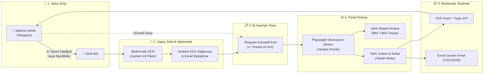

<div align="center">

# 🥖 e-Fatura Süreç Otomasyonu
### Fırın & KOBİ'ler İçin Çok Modlu Telegram & Veriban Entegrasyon Motoru

**Fırın tezgahındaki el yazısı defterlerden ve Telegram ses/metin mesajlarından tek tıkla resmi e-fatura taslağı oluşturan yeni nesil otomasyon sistemi.**

<br/>

[](https://github.com/whywouldnt)
[](https://ai.google.dev/)
[](https://playwright.dev/)
[](https://core.telegram.org/)
[](README.md)

<br/>

[🌟 Özellikler](#-öne-çıkan-özellikler) • [🏗️ Mimari & Çalışma Mantığı](#️-mimari--çalışma-mantığı) • [📱 Kullanım Senaryoları](#-kullanım-senaryoları) • [💼 İşletmeniz İçin İletişim & Abonelik](#-işletmeniz-için-iletişim--abonelik)

</div>

---

## 💡 Çözülen Problem

Geleneksel fırınlar, unlu mamul üreticileri, toptancılar ve saha dağıtımı yapan KOBİ'ler için ay sonu fatura kesim süreçleri büyük bir operasyonel yüktür:

- ❌ **Dağınık Notlar & Karışık El Yazıları:** Gün boyu tezgaha, un çuvalı üstüne veya defter sayfalarına karalanmış ekmek/ürün çeteleleri.
- ❌ **Saatler Süren Portal Girişleri:** Muhasebe veya e-fatura portalına (Veriban vb.) tek tek girip müşteri aramak, vergi numarası kontrol etmek, KDV ve kuruş küsuratlarını hesaplamak.
- ❌ **Kullanıcı Hataları:** Yanlış KDV oranı seçimi, birim fiyatın kuruş yerine tam yazılması veya yanlış cariye fatura kesilmesi riski.
- ❌ **Zaman Kaybı:** Ay sonlarında işletme sahibinin veya muhasebecinin saatlerce bilgisayar başında mesai harcaması.

> **Bu Proje Ne Yapıyor?**  
> Fırın sahibi ya da dağıtım şoförü, fırın defterinin fotoğrafını çeker veya Telegram'dan tek bir mesaj atar (*"kardesler 1200 ekmek 8.5 tl, özlem 500 ekmek"*).  
> Sistem görseli/metni anında okur, hesaplamaları yapar, Telegram'a net bir onay kartı getirir. **`[Onayla]`** butonuna basıldığı anda tarayıcı robotu Veriban portalında faturaları resmi taslak olarak hazırlar, ekran görüntüsünü alır ve PDF'leri teslim eder.

---

## 🏗️ Mimari & Çalışma Mantığı



---

## 🌟 Öne Çıkan Özellikler

### 1. 📸 Multimodal Görsel & El Yazısı OCR
- Unlu, yağlı veya aceleyle çizilmiş fırın çetelelerini ve adisyon defterlerini satır satır çözümler.
- Türkçe karakter hatalarına, eksik hecelemelere ve yöresel esnaf lakaplarına karşı yüksek toleranslı NLP eşleştirmesi uygular.

### 2. ⚡ Akıllı Portala Entegrasyon (Veriban Motoru)
- **Canlı Alıcı Arama:** Portaldaki kayıtlı carileri milisaniyeler içinde arayıp otomatik seçer.
- **Dinamik Modül Tespiti:** Müşterinin durumuna göre otomatik olarak **E-Fatura (`BKF`)** veya **E-Arşiv (`BKA`)** yönlendirmesi yapar.
- **Önceki Ay Sonu Kuralı:** Ayın ilk günlerinde kesilen faturaların resmi tarihini hatasız biçimde bir önceki ayın son gününe (ör. `31.10.2026`) ayarlar.
- **Hassas Inputmask Koruması:** Portalın maskeli birim fiyat alanlarında kuruş yutulması (`12.5` yerine `125` yazılması) gibi riskleri sıfıra indiren mekanizma.
- **Açıklama / Not İzolasyonu:** Çoklu müşteri mesajlarında fatura notlarını (ör. *"ekim ayı faturası"*) yalnızca ilgili carinin portal notlar paneline yazar.

### 3. 🛡️ Sıfır Risk & Güvenlik Kalkanı
- **Taslak Modu (`VERIBAN_DRAFT_ONLY`):** Faturalar doğrudan resmi GİB onayına gitmez; önce Veriban *"Taslak Faturalar"* ekranına kaydedilir ve ekran görüntüsü kullanıcıya sunulur.
- **Kuruş Sağlama Freni (Fail-Closed):** Portalın hesapladığı genel toplam ile taslak toplamı arasında kuruş farkı dahi çıksa işlem anında durdurulur.
- **Yetkilendirme:** Bot sadece izin verilen telefon numaraları/Chat ID'leri ile çalışır.
- **Kendi Kendini Onaran Tarayıcı (Self-Healing):** Tarayıcı kapansa veya profil kilitlense bile oturumu otomatik kurtarır.

### 4. 📊 Muhasebe ve Arşivleme Standartları
- İndirilen faturalar `output/YYYY-MM/` hiyerarşisinde müşteri adına göre kataloglanır.
- Muhasebecinizin tek tıkla Excel'de açabileceği UTF-8 BOM destekli **İcmal CSV** ve **JSON** raporları oluşturulur.
- Toplu ZIP arşivi Zip-Slip güvenlik kalkanıyla paketlenip Telegram sohbetine teslim edilir.

---

## 📱 Kullanım Senaryoları

````carousel
<!-- slide -->
### 💬 Senaryo 1: Hızlı Telegram Mesajı
İşletme sahibi sahada yürürken bota tek bir mesaj atar:
```text
bioden 1000 ekmek 12.5 tl aciklama: ekim ayi faturasi, santex 2300 ekmek 8.5 tl
```
<!-- slide -->
### 📋 Senaryo 2: Anında Onay Kartı
Bot mesajı saniyeler içinde analiz eder ve doğrulanmış onay kartını getirir:
```text
📋 Fatura Taslağı (2 Adet Esnaf):
━━━━━━━━━━━━━━━━━━━━━
1️⃣ BİODEN
   • Tarih: 31.10.2026 (Önceki Ay Sonu)
   • Kalemler: 1.000 Adet Ekmek x 12,50 TL (%1 KDV)
   • 📝 Not/Açıklama: ekim ayi faturasi
   • Toplam: 12.625,00 TL

2️⃣ SANTEX
   • Tarih: 31.10.2026 (Önceki Ay Sonu)
   • Kalemler: 2.300 Adet Ekmek x 8,50 TL (%1 KDV)
   • Toplam: 19.745,50 TL
━━━━━━━━━━━━━━━━━━━━━
Genel Toplam: 32.370,50 TL

[✅ Onayla ve Kes]  [❌ İptal Et]
```
<!-- slide -->
### 📸 Senaryo 3: Fırın Çetelesi Fotoğrafı
Fırın tezgahındaki defterin fotoğrafı çekilir ve açıklama yazılır:
> *"Kasım ayı sonu faturaları, ekmek 8.5 TL"*
Multimodal Vision motoru el yazısını çözer, esnafları eşleştirir ve aynı onay kartını üretir.
<!-- slide -->
### 🚀 Senaryo 4: Otomatik Portala Giriş ve Teslimat
`[✅ Onayla ve Kes]` butonuna basıldığında Playwright motoru Veriban'da taslakları oluşturur; fatura PDF'leri, portal ekran görüntüleri ve Excel icmal listesi Telegram'a anında iletilir.
````

---

## 🛠️ Teknoloji Yığını

| Alan | Kullanılan Teknolojiler |
| :--- | :--- |
| **Yapay Zeka & OCR** | Google Gemini 3.8 Flash Multimodal Vision / Xiaomi MiMo |
| **Tarayıcı Otomasyonu** | Python Playwright (Chromium Headless & Headed) |
| **Kullanıcı Arayüzü** | Python Telegram Bot API (Asenkron & Webhook/Polling) |
| **Veri & Doğrulama** | Pydantic v2, Python `decimal.Decimal` (ROUND_HALF_UP) |
| **Veri Formatları** | PDF Cataloging, UTF-8 BOM CSV, JSON, Zipfile Güvenlik Kalkanı |
| **Mühendislik & Test** | Pytest (122+ Kapsamlı Birim ve Entegrasyon Testi) |

---

## 🔒 Güvenlik & Kapalı Kaynak Mimarisi

> [!IMPORTANT]
> **Telif ve Fikri Mülkiyet Bildirimi:**  
> Bu depo bir **vitrin ve yetenek tanıtım (showcase) sayfasıdır**. Sistemin yüksek performanslı motor kodları, Veriban portal seçici algoritmaları, self-healing oturum yönetimi ve kurumsal iş mantığı gizli/kapalı kaynak (**proprietary**) olarak korunmaktadır.

- **Veri İzolasyonu:** Her işletmenin verileri, tarayıcı profilleri ve oturum çerezleri tamamen izole çalışır.
- **Sıfır Veri Sızıntısı:** Müşteri veritabanları veya kimlik bilgileri asla harici sunucularla paylaşılmaz.
- **Fail-Closed Tasarım:** Şüpheli veya doğrulanamayan hiçbir işlem resmi portala yansıtılmaz.

---

## 💼 İşletmeniz İçin İletişim & Abonelik

Bu sistemi kendi fırınınız, unlu mamuller tesisiniz, gıda dağıtım ağınız veya toptancı işletmeniz için kullanmak ister misiniz?

### 🚀 Neler Sunuyoruz?
1. **İşletmenize Özel Kurulum:** Kullandığınız fatura serileri (`BKF`, `BKA` vb.), esnaf rehberiniz ve KDV oranlarınıza göre 24 saat içinde anahtar teslim entegrasyon.
2. **Özel Portal Uyarlaması:** Veriban haricinde farklı bir e-fatura portalı (Paraşüt, Bizmu, Uyumsoft, Logo, Mikro vb.) kullanıyorsanız sisteme entegre edilebilir.
3. **Bulut / Sunucu Yönetimi:** Bilgisayarınızı açık tutmanıza gerek kalmadan 7/24 bulut sunucu üzerinden Telegram ile kesintisiz kullanım.
4. **Bakım & Güncelleme:** Portal veya mevzuat değişikliklerinde anında güncelleme desteği.

---

### 📩 İletişim Kanalları

İşletmenize özel demo talep etmek, sistemi denemek veya aylık abonelik koşullarını öğrenmek için dilediğiniz kanaldan ulaşabilirsiniz:

- **GitHub İletişim:** [@whywouldnt](https://github.com/whywouldnt)
- **Demo / İş Talebi:** [GitHub Discussions / Issues Üzerinden Mesaj Bırakın](https://github.com/whywouldnt/e-fatura-surec-otomasyonu/issues)
- **E-posta:** alirizaicenn@gmail.com

---

<div align="center">
<sub>Geliştirici & Sistem Mimarı: <strong>whywouldnt</strong> • © 2026 Tüm Hakları Saklıdır.</sub>
</div>
